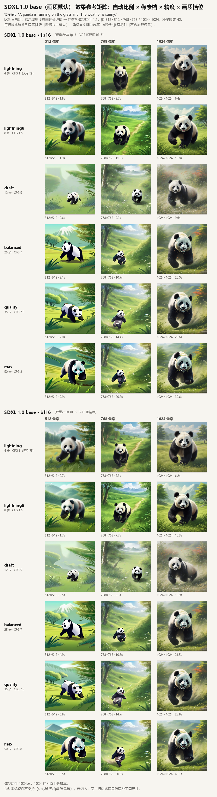
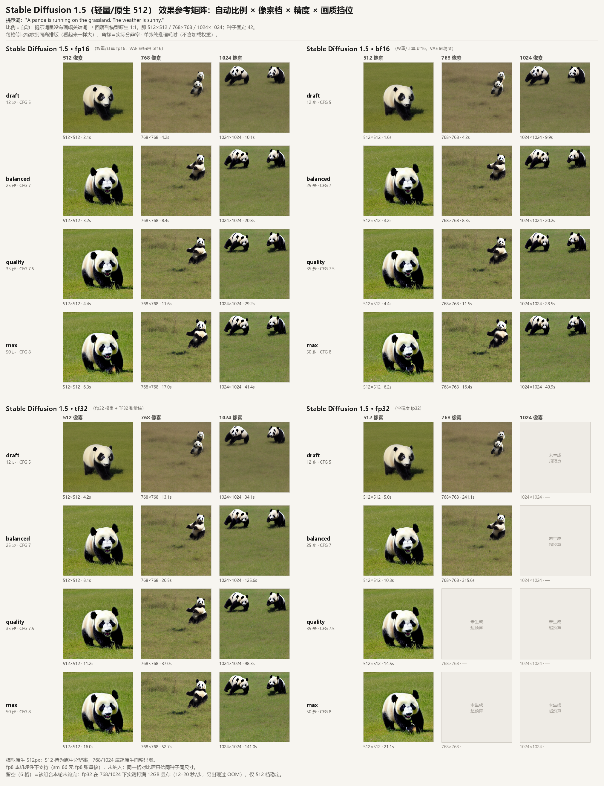
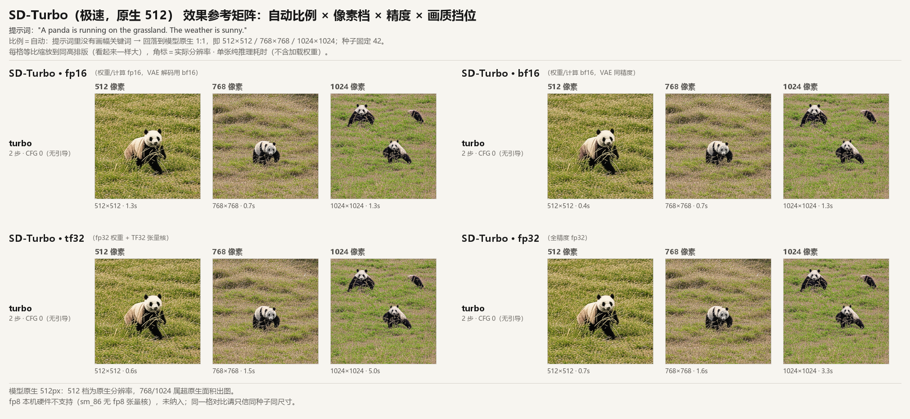

# sd-gen-img-win — 本机离线生图

文生图 / 图生图，3 个底模（`sd-turbo` / `sd15` / `sdxl`）× 4 档精度 × 最多 6 档画质，
全部在本机离线跑，不联网推理。开发与实测环境：**RTX 3060 12GB（sm_86）+ 32GB 内存 /
驱动 617.42 / torch 2.14.0+cu126 / diffusers 0.41.0 / Windows 11**。

本文只有三节：**① 安装**、**② 拼图测试结果**、**③ 结论与踩坑**。

---

## 1. 安装

### 1.1 前置条件

| 项 | 要求 | 说明 |
|---|---|---|
| 系统 | Windows 10/11 x64 | 脚本按 PowerShell 5.1 兼容编写 |
| 显卡 | NVIDIA，≥ 8GB 显存 | 本机 RTX 3060 12GB；fp8 需 sm_89+（本卡没有） |
| 内存 | ≥ 16GB | 本机 32GB（SDXL 加载时还要同时承载权重与 offload 缓冲） |
| Python | conda（Miniconda/Anaconda） | 脚本会建名为 `genimg` 的环境，Python 3.12 |
| 磁盘 | ≥ 25GB | 权重 16.3GB + 输出 |

### 1.2 一键安装

```powershell
# 建环境 + 装 CUDA 版 torch + 依赖 + 下载权重（约 16.3GB）
powershell -ExecutionPolicy Bypass -File setup.ps1

# 只装环境，权重稍后单独下
powershell -ExecutionPolicy Bypass -File setup.ps1 -SkipModels
```

`setup.ps1` 做四件事：

1. 创建/复用 conda 环境 `genimg`（Python 3.12）；
2. 从 PyTorch 官方 CUDA 索引装 `torch 2.14.0+cu126` / `torchvision 0.29.0`
   （PyPI 的 Windows 轮子不带 CUDA，必须走 `download.pytorch.org`）；
3. 按 `requirements.txt` 装其余依赖：`diffusers 0.41.0` / `transformers 5.20.0` /
   `accelerate 1.15.0` / `peft 0.21.2` / `safetensors 0.8.0` / `huggingface_hub 1.33.0` /
   `tokenizers 0.23.3` / `pillow 12.3.0` / `numpy 2.5.2`；
4. 调用 `tools\fetch_models.py` 下载权重到 `models\`（可加 `-SkipModels` 跳过）。

常用参数：`-EnvName <名字>`、`-Recreate`（重建环境）、`-SkipTorch`（已有 torch 时）、`-CudaTag cu126`。

### 1.3 权重清单

```powershell
python tools\fetch_models.py                                  # 默认全量
python tools\fetch_models.py --only sdxl --only lora           # 只下 SDXL 与 Lightning LoRA
python tools\fetch_models.py --hf-source huggingface           # 直连 huggingface.co（默认走 hf-mirror）
```

| 键 | 仓库 | 体积 | 用途 |
|---|---|---|---|
| `sd15` | `stable-diffusion-v1-5/stable-diffusion-v1-5` | 6.4GB | 原生 512，fp32+fp16 两套权重（精度对照用） |
| `sdxl` | `stabilityai/stable-diffusion-xl-base-1.0` | 6.9GB | 原生 1024，只拉 fp16 变体 |
| `sd-turbo` | `stabilityai/sd-turbo` | 2.2GB | 512 原生少步模型 |
| `lora` | `ByteDance/SDXL-Lightning` | 0.8GB | SDXL 的 4 步 / 8 步加速 LoRA |

默认走 `hf-mirror.com` 镜像，下载带重试与续传。

### 1.4 验证安装

```powershell
powershell -File run.ps1 --list
```

预期看到四块：硬件能力（`sm_86`、显存、torch/CUDA 版本、TF32/bf16/fp8 是否可用）、
模型档案（含「已缓存 / 未下载」）、4 档精度（`fp8` 明确标为不可用并给原因）、7 档画质。
再看一眼能不能出图：

```powershell
powershell -File run.ps1 "a panda, cinematic" -m sd-turbo -g turbo -s 512x512
```

### 1.5 开始用

```powershell
# 网页界面（推荐）：双击 web.bat，自动预热默认挡位并打开浏览器
powershell -ExecutionPolicy Bypass -File web.ps1 -Port 8080 -Open
powershell -ExecutionPolicy Bypass -File web.ps1 -NoPreload  # 不预热（写成 -Preload:$false 会透传失败）

# 命令行
powershell -File run.ps1 "a panda on the grassland, sunny" -m sdxl -p bf16 -g balanced -s 1024x1024
powershell -File run.ps1 --image .\in.png --strength 0.5 "watercolor painting style"
powershell -File run.ps1 "水墨山水，留白 [尺寸=768x768] [精度=fp16] [画质=max]"
```

- 提示词里可直接写 `[精度=]` `[画质=]` `[尺寸=]` `[模型=]` `[步数=]` `[cfg=]` `[种子=]` `[强度=]` `[负向=]`；
  优先级 **命令行 > 提示词指令 > 默认值**，来源会打印出来。
- 成品落在 `outputs\<时间戳>\`，文件名含模型/精度/画质/种子，PNG 内嵌完整参数（可用可复现命令重新出图）。
- 网页是单任务串行队列；`7860` 被占用会自动往后找端口。

> 安装期遇到的坑（pip 装错目录、PowerShell 编码、HF 缓存路径等）已整理在 §3.5。

---

## 2. 拼图测试结果

### 2.1 怎么测的

| 项 | 设置 |
|---|---|
| 硬件 | **RTX 3060 12GB（sm_86）+ 32GB 内存**，Windows 11，torch 2.14.0+cu126 |
| 提示词 | `A panda is running on the grassland. The weather is sunny.`（英文、无画幅关键词） |
| 种子 | 固定 `42`（同一行三张同种子、不同分辨率） |
| 比例 | 界面里的「**自动**」→ 提示词无画幅词 → 回落模型原生 1:1 |
| 像素档 | `512` / `768` / `1024` → 实际输出 512×512、768×768、1024×1024 |
| 组合 | SDXL：2 精度 × 6 画质；SD1.5：4 精度 × 4 画质；SD-Turbo：4 精度 × 1 画质 |
| 总数 | 96 格，完成 90 格（sd15/fp32 的 6 格显存打满未跑完，图中标「未生成 / 超预算」） |

拼图里每格都等比缩放到同高，**看起来一样大不代表分辨率一样**；每格角标是
`实际分辨率 · 单张纯推理耗时（不含加载权重）`。脚本：`tools\gen_matrix.py`（批量出图）与 `tools\make_sheet.py`（拼版），可原样复现：

```powershell
python tools\gen_matrix.py --model sdxl     --precisions fp16,bf16
python tools\gen_matrix.py --model sd15     --precisions fp16,bf16,tf32,fp32
python tools\gen_matrix.py --model sd-turbo --precisions fp16,bf16,tf32,fp32
python tools\make_sheet.py --manifest outputs\ref_matrix\<model>-<stamp>\manifest.json
```

### 2.2 SDXL：fp16 / bf16 × 6 档画质 × 3 档尺寸（36 张）



- **1024 是 SDXL 的主场**：主体完整、草地光影与毛发层次都在，`balanced`（20–21.5s）已够用，`max` 39.6–40.1s 边际收益很小。
- **512 掉出训练分布**：整体退化成扁平矢量/插画风、主体偏小；`draft`（12 步）在 512 下还会出现
  竖条纹 + 拼贴式崩坏（换成 seed 43 复测更严重，六格拼贴）——这是 SDXL 的 512 老问题，与精度无关。
- **fp16 与 bf16 肉眼无差**：同尺寸同挡位，差别只在噪点级细节，耗时基本持平（如 1024/balanced：20.0s vs 21.5s）。

### 2.3 SD1.5：4 精度 × 4 档画质 × 3 档尺寸（42/48 张）



- **512 干净、构图正常**，这是它的原生分辨率；同挡位下 `balanced` 3.2s、`max` 6.3s。
- **768 主体明显缩小、画面发灰**；**1024 直接出现两只熊猫**（重复主体）——超原生面积出图的典型症状。
- **4 个精度看不出画质差别**，但速度差一个数量级：1024/balanced 下 fp16 20.8s、tf32 125.6s。
- **fp32 只有 512 能用**：768 起就把 12GB 打满，单步掉到 12–20 秒（12 步要 241s），还出现过 OOM。

### 2.4 SD-Turbo：4 精度 × turbo × 3 档尺寸（12 张）



- **2 步出图**，单张纯推理 0.4–5s，四个精度几乎一模一样（fp16/bf16 在 512 都是 0.4–1.3s）；
  512 首图含权重加载约 10 秒，之后每张 1 秒内。
- 512 主体完整；**1024 出现双主体**（2 步 + 超原生面积，主体先验直接复制）。
- 适合当"探提示词/探构图"的草稿机，不适合当成品分辨率。

---

## 3. 结论与踩坑

### 3.1 分辨率是第一杠杆，模型选型围着它转

| 模型 | 原生 | 512 | 768 | 1024 |
|---|---|---|---|---|
| `sd-turbo` | 512 | ✅ 主体完整、0.4–1.3s | ⚠️ 主体变小 | ❌ 双主体 |
| `sd15` | 512 | ✅ 干净、3.2s | ⚠️ 主体缩小、发灰 | ❌ 双主体 |
| `sdxl` | 1024 | ❌ 矢量/插画风，低步数拼贴崩坏 | ⚠️ 卡通插画，构图尚可 | ✅ 写实质感、20–46s |

- **要 512 就用原生 512 的模型**（`sd-turbo` 最快，需要 CFG/负向时用 `sd15`）；要 SDXL 的画质就出 1024。
- SDXL 的 512 崩坏**不是 micro-conditioning 能修的**：把 `original_size/target_size` 设成 1024
  照样三格拼贴（A/B 对照做过），本质是原生 1024 的模型在分布外分辨率工作。
- 768 是个"不上不下"的档：三个模型都能出，但主体都会偏小；只适合需要 4:3 / 3:4 时按面积换算用。

### 3.2 精度挡位：只在这三种场合才需要选

先看数据（`balanced` 单张纯推理耗时，秒；同种子同尺寸）：

| 模型 | 精度 | 512 | 768 | 1024 |
|---|---|---|---|---|
| SDXL | fp16 / bf16 | 5.06 / 4.89 | 10.65 / 10.61 | 20.02 / 21.47 |
| SD1.5 | fp16 / bf16 | 3.20 / 3.17 | 8.36 / 8.30 | 20.78 / 20.22 |
| SD1.5 | tf32 | 8.08 | 26.50 | 125.57 |
| SD1.5 | fp32 | 10.34 | 315.62（显存打满） | 跑不完 |
| SDXL | tf32 / fp32 | 已禁用：单张 60s+、画质无收益 | | |

**fp16 与 bf16 显存占用完全相同（都是 2 字节/参数），速度差在 ±5% 以内，画质肉眼无差。**
所以精度不是"画质开关"，只在这三种场合才有意义：

1. **显存边界**——决定能不能跑。fp32 的 SD1.5 权重 3.97GB，加上 768 的激活就把 12GB 占满并触发分页；
   SDXL 的 fp32/tf32 权重 13.9GB，直接进 `sequential_offload`，单张 60s+，已在模型档案里禁用。
2. **速度预算**——30s/张的约束下，1024 只有 fp16/bf16 能过（20s），tf32 直接 125s 出局。
3. **排障基线**——怀疑黑图/花屏是数值问题时，用 fp32 在 512 跑一张对照；它是工具，不是生产挡位。

选哪个：**默认 bf16**（与 fp16 同速，8 位指数不会溢出）；Turing 及更老的老卡没有 bf16 单元，
只能 fp16（本项目会自动把 fp16 挡位的 VAE 解码回落到 fp32）；`fp8` 需要 sm_89+，本机直接拒绝。

8GB 显卡的推算（按本项目 `plan_placement` 公式，可用显存按 6.8GB 估）：

| 模型 / 精度 | 权重 | 512 | 768 | 1024 |
|---|---|---|---|---|
| `sd-turbo` fp16/bf16 | 1.99GB | 全量驻留 | 全量驻留 | 全量驻留 |
| `sd15` fp16/bf16 | 2.40GB | 全量驻留 | 全量驻留 | 全量驻留 |
| `sdxl` fp16/bf16 | 6.46GB | 模型级 offload | **顺序卸载（不可用）** | **顺序卸载（不可用）** |
| `sd15` fp32 | 3.97GB | 全量驻留 | 模型级 offload | 模型级 offload |

结论：8GB 上换 fp16 省不出显存（占用和 bf16 一样）；真正有效的是**降分辨率、开 VAE tiling/attention slicing、换小模型**。

### 3.3 画质挡位：收益曲线很陡，然后迅速变平

| 挡位 | 步数 / CFG | 1024 单张 | 说明 |
|---|---|---|---|
| `lightning` | 4 / 1.0 | 6.4–7.2s | 挂 Lightning LoRA，CFG≤1 = 关闭引导，负向不生效 |
| `lightning8` | 8 / 1.5 | 10.8–11.5s | 同上，细节稍好，仍远快于常规采样 |
| `draft` | 12 / 5.0 | 9.6–10.9s | 草稿；SDXL 在 512 下会拼贴崩坏 |
| `balanced` | 25 / 7.0 | 20.0–21.5s | **默认**，提示词遵从度明显好于 draft |
| `quality` | 35 / 7.5 | 28.6–28.8s | 纹理更完整；1024 下已贴近 30s 预算 |
| `max` | 50 / 8.0 | 39.6–40.1s | 超预算，只当质量上限参考 |
| `turbo` | 2 / 0.0 | 1.3s | 仅 sd-turbo；CFG=0，负向不生效 |

- **draft → balanced 是唯一明显的一档**（构图与提示词遵从度），之后 quality/max 是边际递减。
- 1024 出图时 `quality`/`max` 会越过 30s 预算；1024 日常就用 `balanced`，要快就用 `lightning`（代价是失去 CFG）。
- 需要负向提示词/CFG 的场景，只能选 `draft` 及以上。

### 3.4 显存与放置策略：先算，再决定 offload

引擎按下面这条公式决定权重放哪（`genimg/runtime.py::plan_placement`）：

```
需要显存 = 权重GB × 1.15（临时缓冲） + 激活预留（≤640px 取 1.2GB，更大取 2.5GB）
放得下（≤ 可用×0.92）      → gpu（全量常驻）
放不下但最大组件放得下      → model_offload（每步只搬 UNet，通常仍可用）
连最大组件都放不下          → sequential_offload（逐层搬，慢 10 倍以上）
```

12GB 上的实测边界：

| 组合 | 权重 | 决策 | 结果 |
|---|---|---|---|
| SDXL 512 | 6.46GB | gpu | 5.1s |
| SDXL 768 / 1024 | 6.46GB | model_offload | 10.6s / 20s（可用） |
| SDXL fp32 / tf32 | 13.9GB | sequential_offload | 60s+（已禁用） |
| SD1.5 fp32 768 | 3.97GB | gpu（估算通过） | **实际占 11.9GB → 分页，12–20s/步** |

最后一行是重点：**估算通过不等于真的放得下**。Windows 的 WDDM 允许显存超卖、走 PCIe 换页，
于是不会抛 OOM，只表现为"突然变慢 30 倍"。所以看到"某挡位莫名变慢"，
先看 `nvidia-smi` 显存是否贴近上限，而不是先怀疑显卡不行。

### 3.5 踩坑清单

按症状排，前四条都是"不报错、只是变慢/变丑"的类型，全部已在代码里修掉，记下来防复发。

1. **换了精度挡位却更慢（最坑）**：`Img2ImgPipeline.from_pipe()` 在未显式传 dtype 时，
   diffusers 内部默认把整条管线转成 `float32` → fp16 权重被抹成 fp32（SDXL 13.9GB），
   超出 12GB 后分页，表现为 SDXL 单步 2.4s（正常 0.12s）。修法：`from_pipe` 显式传 dtype，
   装配后再**回读各组件真实 dtype 纠正一次**。教训：传参成功 ≠ 生效。
2. **管线缓存污染放置决策**：同一进程先跑 fp32 再跑 fp16，新管线做显存估算时看到的是
   被旧管线占掉的显存，于是被误判成要逐层卸载。修法：换精度前先 `_evict_all()`（清缓存 + `gc` + `empty_cache`）。
3. **fp16 的 latent 撞上 fp32 的 VAE**：`Input type (Half) and bias type (float) should be the same`。
   SDXL 管线里有"按需把 latent 转成 VAE 精度"的逻辑，但只在它自己管理 VAE 时触发；
   手动把 VAE 提到 fp32 后这段逻辑失效。修法：整体按主精度加载 → 装配后再调 VAE 精度 →
   **在采样最后一步**把 latent 转成 VAE 精度（中途转会把 fp32 latent 送回 fp16 UNet）。
   现在 fp16 挡位的 VAE 解码用 bf16（1024² 解码 654ms，fp32 要 1253ms，输出逐字节一致）。
4. **图生图把参考图压扁**：`resize((512,512))` 会把 1024×683 的横图横向压扁 1.5 倍。
   修法：`fit_image()` 等比缩放 + 自身放大模糊留白（或 cover 裁切），绝不拉伸。
5. **图生图"强度 0.5 却没效果"**：实际采样步数 = `int(步数 × 强度)`。`turbo`（2 步）× 0.5 = **1 步**，
   只够重涂一层。做风格改造用 `sd15` + `balanced` + 强度 0.5–0.7。
6. **负向提示词不生效**：`turbo`/`lightning` 的 CFG ≤ 1（等于关闭引导）。要负向就选 CFG>1 的挡位。
7. **长提示词被静默截断**：CLIP 单次只吃 **77 token**。实测一份 4942 字符的海报提示词是 835 token，
   **约 91% 被丢掉**，"下半部分画插画"这类版式指令根本没进模型。版式类需求要么用两段式拼版（代码控制），
   要么换支持版式控制的模型；改提示词没用。
8. **中文提示词效果弱**：CLIP 以英文语料为主。内置 163 条离线词典把风格/画质/光影/材质翻成英文，
   剔除"请帮我""把图片改为"这类无效措辞；验证方式是同参数同种子与直接写英文**像素完全一致**（SHA256 相同）。
   词典覆盖不到的自由描述（主体、动作、关系）会原样保留并提示，不假装翻译。
9. **风格词被无视**（如 `American comic style` 出照片）：旧模型听不懂抽象风格名。
   内置风格展开表（14 类）把风格名换成具体视觉特征（粗黑描边/平涂/网点），只在"识别到风格名且没写配套细节"时展开，
   避免把提示词撑过 77 token。
10. **SDXL 512 像插画 → 不是精度问题**：同模型同挡位只改分辨率，512 是扁平矢量、1024 是写实质感；
    精度切换（fp16/bf16）对观感没有影响。见 §3.1。
11. **pip 装到别的目录**：会话注入的 `PIP_USER=1` / `PYTHONUSERBASE` 会让包装进 AutoClaw 的 toolchain，
    目标环境里"装成功但找不到"。修法：安装/运行时显式 `PIP_USER=0`、`PYTHONNOUSERSITE=1`、
    清空 `PYTHONUSERBASE`（已写进 `scripts\common.ps1`）。
12. **PowerShell 5.1 的两个坑**：`.ps1` 必须是 **UTF-8 with BOM**，否则中文乱码；
    空环境变量（本机 `$env:LOCALAPPDATA` 为空）会让 `Join-Path` 在数组字面量里直接报
    `Cannot bind argument to parameter 'Path'` —— 每个候选路径先判空，并用 `$PSCommandPath` 推导脚本根目录。
13. **HF 缓存路径改不动**：`huggingface_hub` 的缓存路径在首次 import 时就固化了，之后再设 `HF_HOME` 无效。
    修法：给 `from_pretrained`/`snapshot_download` **显式传 `cache_dir`**。
14. **模型已缓存后应完全离线**：加载时用 `local_files_only`，镜像抽风（实测遇到 403）也不影响出图；
    反之未缓存且断网时，直接提示"先跑 `tools\fetch_models.py`"，而不是丢一堆堆栈。
15. **API 不传像素档时 SDXL 被压进 512 基准**：`/api/generate` 曾把缺省 `pixels` 硬编码为 512，
    显式比例分支又把它当 `base_override` 传进 `sizing.resolve`（优先级高于模型原生分辨率），
    于是 SDXL + size=9:16 出 320×576——正好落进 512 的分布外退化区（§3.1）。修法：`pixels`
    未传时回落**模型原生基准**（SDXL 9:16 → 768×1344）；界面始终显式传像素档，行为不变。
    由 `tools\test_ratio_916.py` 复测发现。

### 3.6 已知限制 / 未完成

- **sd15 的 fp32 在 768/1024 没跑完**（拼图里 6 格标"未生成 / 超预算"）：768 实测 12–20 秒/步，
  1024 更差。要补齐需要先加 VAE tiling + attention slicing 压峰值，再重跑。
- **SDXL 的 fp32 / tf32 已禁用**：13.9GB 权重在 12GB 上只能顺序卸载，单张 60s+，画质无收益。
- **fp8 不可用**：需要 sm_89（Ada/Hopper），本机 sm_86 没有 fp8 张量核，软件绕不过；
  界面里置灰并显示原因，命令行会明确报错。
- **`turbo` / `lightning` 无 CFG**：负向提示词不生效，风格改造请避开这两个挡位。
- **Web 是单任务串行**：单卡并发只会互抢显存；请求进队列排队，端口占用自动 +1。
- 控制台里 `should be kept in float32: []`、LoRA 的 `No LoRA keys ...`、`upcast_vae is deprecated`
  这几条是无害播报（方括号为空说明无需保留的模块），已按消息关键字精确屏蔽；
  `Token indices sequence length is longer than ...` 是有用提示（提示词超长），保留。

### 3.7 提示词体检的规范借鉴：Qwen-Image-2.1 官方规范（2026-10）

`advice.py` 里“要素完整度 / 空泛画质词 / 图内文字”三类体检借鉴自阿里巴巴 Qwen-Image-2.1
官方提示词重写规范（经 [iamyoki/qwen-image-2.1-skill](https://github.com/iamyoki/qwen-image-2.1-skill) 转述，Apache-2.0）。
该规范为其长上下文文本编码器设计（400–500 词“观察者长文”），**不能照搬**到本项目的
CLIP 77-token 预算（§3.5 第 7 条：超长部分静默截断），只压缩采纳了它的“要素清单”思想：

1. **要素完整度**：一条好提示词 = 媒介/风格 + 主体 + 光影 + 镜头/构图 + 色调/氛围。
   主体由你写，其余缺两项以上时体检给一条“缺啥补啥”提示，示例词全部是词典已收录的词
   （中文写会自动转英文）；
2. **空泛画质词**：`masterpiece / 8K / award winning` 不描述任何画面内容，提示词超过约
   40 token 时点名提示并算出可省的 token 数（词典仍会照翻“大师作品”，不静默丢意图）；
3. **图内文字**：引号里的字建议 1–3 个短词并写明位置与材质；整段版式走两段式拼版
   （`genimg/poster.py`）；
4. **词典扩充**：按官方 cheat sheet 增补光照/材质/媒介/配色词条（116 → 163 条，`zh_prompt.py`）；
5. **画幅关键词**：`手机壁纸 9:16`、`证件照 3:4`、`全景照片 2:1`、`A4 5:7` 等直接触发画幅决策
   （`sizing.py`；模糊写法如“熊猫全景”不会误触发）。

**明确不搬**：Edit 模式的属性解耦（“把 A 换到 B，背景别动”）——Qwen-Image-Edit 是指令式编辑，
本项目图生图是噪声强度式（§3.5 第 4/5 条），提示词里写“保持背景不变”没有对应机制。
